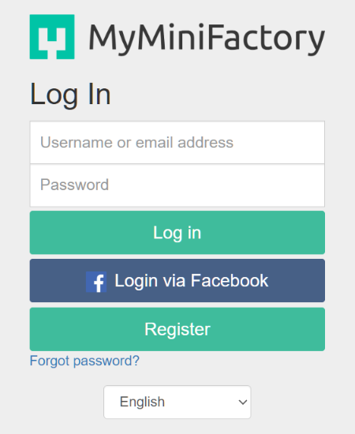

# MMF Downloader

Archives a MyMiniFactory library to local disk.

MMF's download links sit behind a Cloudflare browser check, so downloads go
through **your real Chrome** (via a small extension). Everything else
(library list, file lists, queue, verification, filing) is Node.

```
 MMF API ──> node mmf.js plan ──> data\queue.json
                                       │
 Chrome extension <── node mmf.js serve (localhost bridge)
   downloads file ──> Downloads\MMF-staging ──> verified ──> archive\Creator\Bundle\
```

Requirements: Windows (what it is tested on), Chrome, Node 20+ (no npm dependencies), a MyMiniFactory
account with a password (see step 3), and enough disk space for your library.
The core also runs on macOS/Linux, but the "Start bridge" button, 📌 pin and
"show in Explorer" extras are Windows-only.

Download: green **Code** button → **Download ZIP** on GitHub, unzip anywhere
(or `git clone`).

## One-time setup

1. **Register an MMF app** (free): log in to MyMiniFactory, go to
   Settings → Developers (`https://www.myminifactory.com/settings/developer`) →
   *Register a new OAuth Application*.
   - Client key: any unique slug, e.g. `yourname-library-archiver`
   - Redirect URI: `http://localhost:8765/callback`
   - The client secret arrives by email.
2. Copy `config.example.json` to `config.local.json` and fill in `clientId`,
   `clientSecret` and `archiveRoot` (where the archive should live).
   `config.local.json` and `data\` are git-ignored; they never get committed.
3. `node mmf.js login` → your browser opens MMF's login page → log in and
   approve. The downloader then keeps its own login token (in `data\`, never
   committed) and refreshes it by itself.

   **Signed up with Google? You'll need a password first.** The downloader uses
   MMF's official API, and apps using that API must log you in through MMF's own
   app-login page (`auth.myminifactory.com`). MMF decides what that page offers,
   and it is not the same as the main website's sign-in: it offers email and
   password, or Facebook, but **no "Sign in with Google"** (as of October 2026). The downloader can't add a Google button; it only sends you to MMF's
   page.

   

   An account created with "Sign in with Google" never had an MMF password, so
   there's nothing to type in the Password box. To get one:
   1. On that page, click **Forgot password?** and enter the email address your
      MMF account uses (your Google email).
   2. Open MMF's email and set a password.
   3. Back on the login page, log in with that email and the new password.

   If your MMF account is linked to Facebook, **Login via Facebook** works too.
4. Chrome → `chrome://extensions` → turn on **Developer mode** → **Load unpacked**
   → pick the `extension` folder. Pin "MMF Downloader" to the toolbar; clicking it
   opens the floating dashboard (📌 keeps it on top, Windows).
5. `node mmf.js install-host` (optional, Windows): adds a **Start bridge** button
   to the dashboard so you don't need a terminal to start the bridge. It
   registers a small Chrome helper for your Windows user only (no admin); only
   this extension can call it, and all it can do is open the bridge window.
   Reload the extension afterwards. Re-run it if you move the folder.

## Each run

1. `node mmf.js serve` and leave it running (or click **Start bridge** in the
   dashboard if you ran `install-host`).
2. Chrome toolbar → MMF Downloader → dashboard → **Sync library**. One click
   pulls your library list and release names through your logged-in Chrome
   (read-only), then builds the download list. The first time takes about 1.5
   hours (paced, cached); after that only new models are fetched, so a new
   bundle takes a minute or so. (`node mmf.js plan` does the same from a terminal.)
3. Review Creator ▸ Release ▸ Model with sizes, untick anything
   you don't want (Get/Skip; filter box + Check all / Uncheck all), then **Start**.
   At the hourly cap it waits and resumes on its own (countdown shown).
   ✓ in the last column = already downloaded (click it to show it in Explorer).
   Models a Sync finds for the first time get a **NEW** badge, and **New (n)**
   shows only those, so each month's releases stand out.
   Choices are remembered across re-plans and can be changed mid-run.

`node mmf.js status` shows progress any time. Stop/start freely; it resumes.
**History** (dashboard header) lists what was downloaded, retried or failed,
and when runs started, paused and finished, newest first. Filter it, search it,
and click a download to show it in Explorer.

**Long runs:** a big library takes a day or more (the hourly cap sets the pace).
Keep Chrome and the bridge window open, stop the PC from sleeping, and consider
pausing Windows Update for the run (Settings → Windows Update → Pause), since an
update restart stops it. After any restart: **Start bridge**, then **Start**.
Nothing already filed is downloaded again.

## Combining Rescale's Supported/Unsupported pairs (optional, Windows)

Rescale Miniatures ships each creature as `X_Supports.zip` + `X_Unsupported.zip`.
`tools\Combine-RescalePairs.ps1` folds each pair into one `X.zip` holding both
zips unchanged (store mode, no recompression). Needs [7-Zip](https://www.7-zip.org/)
and PowerShell 7 (`pwsh`).

```
pwsh -File tools\Combine-RescalePairs.ps1                      # dry run: shows the plan
pwsh -File tools\Combine-RescalePairs.ps1 -Execute             # do it
pwsh -File tools\Combine-RescalePairs.ps1 -Execute -Only "2025-0*"   # some releases
```

- Dry run by default. Each new zip is built as `.partial`, tested with `7z t`,
  and checked entry by entry against the originals before it gets its name.
- Originals are moved to `_combined_originals` in each release folder for you to
  delete when happy (or add `-DeleteOriginals` to delete them after the checks).
- Folders with files changed in the last hour are left alone (downloads running).
- A stray `X.zip` beside a pair is removed only if it is byte-identical to
  `X_Unsupported.zip`; anything unclear is listed for you to decide.
- The downloader understands combined zips: re-running `plan` counts the files
  inside them as done, and it never overwrites an existing file in the archive.

## Troubleshooting

| Symptom | Fix |
|---|---|
| "Bridge offline" | Click **Start bridge**, or run `node mmf.js serve` |
| "Paused: Got a web page instead of the file" | Open myminifactory.com in Chrome, log in / pass the check, press **Start** |
| `plan` says 401 / not logged in | `node mmf.js login` |
| Start bridge says "one-time setup needed" | `node mmf.js install-host`, then reload the extension |
| Some files failed | Dashboard → **Retry failed** |
| A whole-model download fails with "Not a zip" | Some very old models: download them by hand from their MMF page |
| Files you added by hand get downloaded again | Run `node mmf.js plan` first; it marks files already on disk as done |

## Settings (config.local.json)

| Key | Default | Meaning |
|---|---|---|
| `archiveRoot` | | Where finished files are filed |
| `excludeCreators` | `[]` | Creator names to skip (e.g. ones that moved off MMF) |
| `bundleTitles` | `{}` | `{ "60627": "Hollow Graves" }` to name a release group by hand |
| `maxDownloadsPerHour` | `120` | Hourly cap (community reports ~150/h from MMF) |
| `apiDelayMs` | `3000` | Gap between API calls during `plan` |

## Folder naming

`Creator\Bundle\file.zip`, where Bundle is the earliest Tribe month (`2026-10`),
else the creator's release name as MMF shows it (synced by the extension, e.g.
`2024 - 10 _ October release - Hollow Graves`), else `Loyalty Rewards`,
`Welcome Pack`, `Purchases`, `Free Downloads`, `Frontier <campaign>`.

## Safety behaviour

- The bridge only listens on 127.0.0.1 and only answers the extension.
- It only moves files from the staging folder whose name matches the expected item.
- Every file is checked (exact size from MMF, zip header and end-of-archive record).
  Web pages (Cloudflare check, logged out) **pause the run** instead of failing everything.
- Bad files are retried up to 3 times, then marked failed (dashboard → "Retry failed").
- Models with only loose parts download as one whole-model zip (like the site's
  Download button); loose files it replaces are moved to `_to_delete`, never deleted.
- Re-running `plan` marks files already in the archive as done (gap check), and
  moves already-filed files if their folder name changed instead of re-downloading.
- Models sold both inside a bundle and on their own (same creator, file name and
  exact size) are downloaded once and filed with the bundle.

## Tests

`npm test`

## Status

**1.0** (October 2026): used to archive a 2,500-file, 1.9 TB library end to end.

Personal hobby project, not affiliated with MyMiniFactory. Use it only for
models you own, and respect creators' licences. It uses MMF's official API plus
a few of the website's own library endpoints (read through your logged-in
browser), which may change without notice. Downloads are deliberately paced
(120/hour by default) to be gentle on MMF.

## License

MIT (see [LICENSE](LICENSE)). Provided as is, with no warranty.
